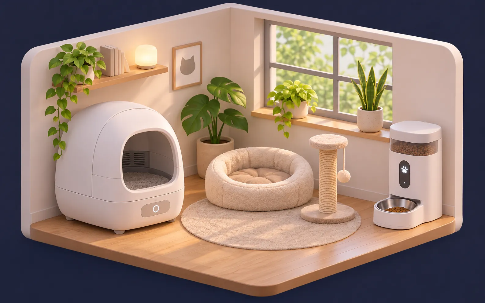

# 🏠 Living House Card

**A living 3D house dashboard for Home Assistant.** Your home as an isometric 3D picture that reacts in real time: rooms go dark when you switch the lights off, TVs glow, LED strips tint the room in their colour, the sky follows the sun and the weather – and every room opens into a beautiful control view.

**[▶ Live demo](https://krystianokris.github.io/living-house-card/demo/)** · [🇵🇱 Polska wersja](README.pl.md) · [Configuration](docs/configuration.md) · [Calibration](docs/calibration.md) · [Make your own 3D house](docs/house-image.md)


> **Status: v0.1 beta.** It works great on the author's home – now it needs yours. Please report bugs and ideas in [Issues](../../issues).

## ✨ Features

| | |
|---|---|
| 💡 **Real light on the picture** | Every room has its own outline. Lights off → the room goes dark; partly on → half-lit (main lights weigh more than LED strips). |
| 🌈 **LED colour** | An RGB strip on? The room glows in its colour. |
| 📺 **TV glow** | A flickering blue/violet glow while the TV plays – and the TV screen on the picture turns black when it's off. |
| 🌗 **Day & night** | Sky, dusk and stars follow `sun.sun` elevation. Manual override button. |
| 🌧️ **Weather effects** | Rain, snow, drifting clouds, fog, lightning – from your weather entity. Keeps the last known weather if the provider is down. |
| 🌡️ **Heat map** | One tap tints every room by its temperature. |
| 🔍 **Room zoom** | Tap a room – the camera flies in, the rest dims, a glass panel shows its devices. |
| 🧊 **Frosted glass UI** | Weather, home status, heating, air, energy (24 h sparkline), scenes. |
| 🖥️ **Fits the screen** | Scales itself to laptops and tablets – no scrolling. Phones get a scrolling layout. |
| 📱 **Tablet mode** | `?kiosk` → full screen; after 3 minutes a clock screensaver with weather. |
| 🎯 **Calibration mode** | Drag labels, draw room outlines with the mouse, copy the YAML. Works with **any** house picture. |
| 🗣️ **Polish & English** | Follows your Home Assistant language. |

### Rooms card

A second card, **`living-rooms-card`**, turns your rooms into a mosaic of big photo tiles. Tap a tile – the photo flies into a full room view with lights (brightness, colours, warm/cool), round thermostat dials, media with artwork, sensors, a 24 h chart and devices like an air purifier, pet feeder, litter box, washer, dryer and a **3D printer** (progress ring, live camera, AMS filament colours, pause/stop).

| Rooms | Room view |
|---|---|
|  |  |

| Day + heat map | Room zoom |
|---|---|
|  |  |

### Cat corner card

**`living-cats-card`** is a living picture of your cat's corner. The scene follows your litter box and pet feeder: the cat appears in the litter box or at the bowl, the litter box glows while it cleans itself, UV light shows in violet, a full bin gets a red ring, and day turns into night with the sun. Glass panels show visits today, cat weight and the last meal, with buttons to clean, feed (choose portions) and toggle night mode, UV or slow feeding. [Configuration](docs/configuration.md#living-cats-card)



## 🚀 Try it without Home Assistant

### 👉 [Open the live demo](https://krystianokris.github.io/living-house-card/demo/)

Fake devices, everything is clickable – switch lights, open rooms, change PL/EN and day/night (buttons in the bottom-right corner).

Or run it locally:

```bash
git clone https://github.com/krystianokris/living-house-card.git
cd living-house-card
python -m http.server 8000
```

Then open <http://localhost:8000/demo/>.

## 📦 Installation

### HACS (recommended)

1. HACS → ⋮ → **Custom repositories** → add `https://github.com/krystianokris/living-house-card`, category **Dashboard**.
2. Install **Living House Card** and reload the browser (Ctrl+Shift+R).

### Manual

1. Download `living-house-card.js` from the [latest release](../../releases/latest).
2. Copy it to `/config/www/living-house-card/`.
3. Settings → Dashboards → ⋮ → **Resources** → add `/local/living-house-card/living-house-card.js` as **JavaScript module**.

## 🏠 Pick a ready-made house

No AI, no calibration, no YAML – **Edit dashboard → Add card → Living House Card**, pick a house from the dropdown and click your lights, sensors and TVs for each room. Labels, room outlines and the TV screen are already in place.

|  |  |  |  |
|:---:|:---:|:---:|:---:|
| `2-bedrooms` | `3-bedrooms` | `basement` | `attic` |
|  |  |  |  |
| `3-bedrooms-basement` | `3-bedrooms-attic` | `basement-attic` | `3-bedrooms-basement-attic` |

Prefer YAML? It works too:

```yaml
type: custom:living-house-card
preset: basement          # any name from the table above
weather: weather.home
rooms:                    # only the rooms you want to connect – by id
  - id: living
    lights: [light.living_room_ceiling]
    tv: [media_player.living_room_tv]
  - id: utility
    name: Boiler room     # rename any room
    temperature: sensor.boiler_temperature
  - id: workshop
    hide: true            # remove a room you don't have
```

Room ids for every house: **[docs/configuration.md → Ready-made houses](docs/configuration.md#ready-made-houses)**. Try them all in the [live demo](https://krystianokris.github.io/living-house-card/demo/?card=house&house=basement).

## 🏁 Quick start – your own house

1. Put a 3D picture of your home in `/config/www/living-house/house.webp` (see [how to make one](docs/house-image.md)).
2. Create a dashboard with a **Panel** view and add the card:

```yaml
type: custom:living-house-card
image: /local/living-house/house.webp
title: My Home
weather: weather.home
rooms:
  - id: living
    name: Living room
    icon: mdi:sofa-outline
    temperature: sensor.living_room_temperature
    lights:
      - light.living_room_ceiling
      - entity: light.living_room_led
        weight: 0.5
```

3. Click the **calibration** button (top right, admins only), drag the label onto the room, draw its outline, press **Copy YAML** and paste it into the card config. Done – the room now reacts to its lights.

Full option list: **[docs/configuration.md](docs/configuration.md)** · Examples: **[examples/](examples/)**

## 🧭 Two dashboards that work together

- **Home** – `living-house-card` with `rooms_page: /my-rooms/rooms` (adds the *Rooms* tab and *Open room* buttons).
- **Rooms** – a hidden dashboard (not in the sidebar) with `living-rooms-card` and `home_path: /my-home/home` (the big *Home* button).

Each room in the house card can link to its room view with `page: <room id>`.

## 🤝 Contributing

Ideas, bug reports and pull requests are welcome!

```bash
npm run build      # builds dist/living-house-card.js from src/
npm run check      # build + syntax check
```

Source: `src/shared.js` (i18n, helpers), `src/house-card.js`, `src/rooms-card.js`, CSS in `src/*.css`. No dependencies.

Translations: add a language block to `LHC_I18N` in `src/shared.js`.

## 📄 License

[MIT](LICENSE) © krystianokris

The demo pictures in `images/demo/` are provided for the demo only – please use your own pictures for your home.
