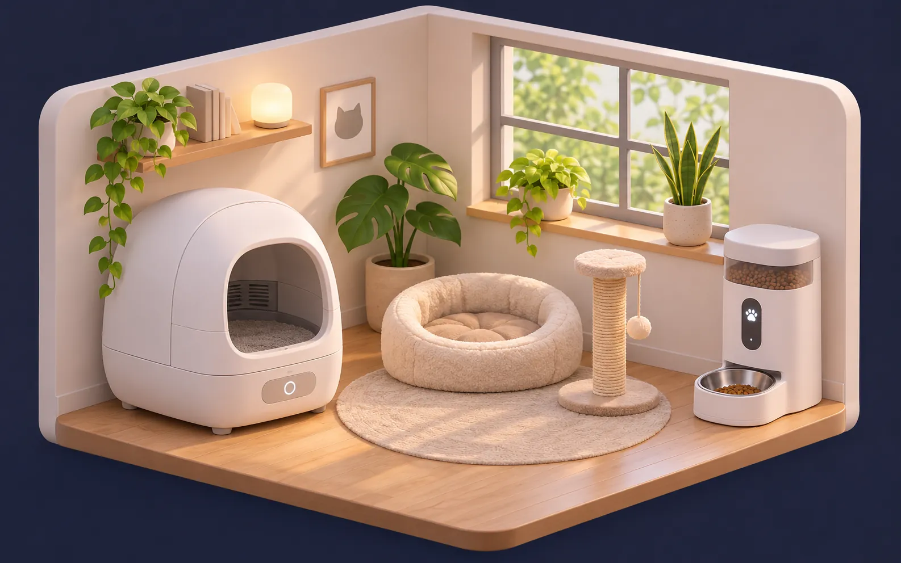

# 🏠 Living House Card

**Żywy dashboard domu 3D dla Home Assistant.** Twój dom jako izometryczny obraz 3D, który reaguje na żywo: pokój ciemnieje, gdy zgasisz światło, telewizory świecą, taśmy LED barwią pokój swoim kolorem, niebo zmienia się ze słońcem i pogodą – a każdy pokój otwiera piękny widok sterowania.

**[▶ Demo na żywo](https://krystianokris.github.io/living-house-card/demo/)** · [🇬🇧 English](README.md) · [Konfiguracja](docs/configuration.md) · [Kalibracja](docs/calibration.md) · [Własny dom 3D](docs/house-image.md)


> **Status: v0.1 beta.** U autora działa świetnie – teraz czas na Twój dom. Błędy i pomysły zgłaszaj w [Issues](../../issues).

## ✨ Co potrafi

| | |
|---|---|
| 💡 **Prawdziwe światło na obrazku** | Każdy pokój ma własny obrys. Światło zgaszone → pokój ciemnieje; częściowo → półmrok (główne światła ważą więcej niż LED-y). |
| 🌈 **Kolor LED** | Taśma RGB świeci na różowo? Pokój dostaje różową poświatę. |
| 📺 **Poświata TV** | Migające niebiesko-fioletowe światło, gdy TV gra – a ekran na obrazku gaśnie, gdy TV jest wyłączony. |
| 🌗 **Dzień i noc** | Niebo, zmierzch i gwiazdy według wysokości słońca (`sun.sun`). Przycisk do wymuszenia. |
| 🌧️ **Pogoda** | Deszcz, śnieg, chmury, mgła, błyski burzy – z encji pogody. Przy awarii serwisu pokazuje ostatnie dane. |
| 🌡️ **Mapa ciepła** | Jednym kliknięciem pokoje barwią się kolorem temperatury. |
| 🔍 **Przybliżanie pokoju** | Klik w pokój – kamera wlatuje, reszta przygasa, obok szklany panel z urządzeniami. |
| 🧊 **Szklany interfejs** | Pogoda, status domu, ogrzewanie, powietrze, energia (wykres 24 h), sceny. |
| 🖥️ **Bez przewijania** | Sam dopasowuje się do laptopa i tabletu. Na telefonie – przewijany układ. |
| 📱 **Tryb tabletu** | `?kiosk` → pełny ekran; po 3 min wygaszacz z zegarem i pogodą. |
| 🎯 **Tryb kalibracji** | Przeciągasz plakietki, myszką rysujesz obrysy pokoi, kopiujesz YAML. Działa z **dowolnym** obrazkiem domu. |
| 🗣️ **Polski i angielski** | Według języka Home Assistant. |

### Karta pomieszczeń

Druga karta, **`living-rooms-card`**, to mozaika dużych kafelków ze zdjęciami pokoi. Klik – zdjęcie płynnie rozrasta się w pełny widok pokoju: światła (jasność, kolory, barwa), okrągłe pokrętła termostatów, multimedia z okładką, czujniki, wykres 24 h oraz urządzenia: oczyszczacz, karmnik, kuweta, pralka, suszarka i **drukarka 3D** (pierścień postępu, kamera na żywo, kolory filamentów z AMS, pauza/stop).

| Pomieszczenia | Widok pokoju |
|---|---|
|  |  |

### Kocia strefa

**`living-cats-card`** to żywy obrazek kociego kącika. Scena podąża za kuwetą i karmnikiem: kot pojawia się w kuwecie albo przy misce, kuweta świeci podczas sprzątania, UV widać na fioletowo, pełny pojemnik dostaje czerwoną obwódkę, a dzień zmienia się w noc razem ze słońcem. Szklane panele pokazują wizyty dziś, wagę kota i ostatni posiłek, z przyciskami: sprzątnij, nakarm (wybór porcji), tryb nocny, UV i wolne karmienie. [Konfiguracja](docs/configuration.md#living-cats-card)



## 🚀 Wypróbuj bez Home Assistant

### 👉 [Otwórz demo na żywo](https://krystianokris.github.io/living-house-card/demo/)

Udawane urządzenia, wszystko da się klikać – światła, pokoje, przełącznik PL/EN i dzień/noc (przyciski w prawym dolnym rogu).

Albo uruchom lokalnie:

```bash
git clone https://github.com/krystianokris/living-house-card.git
cd living-house-card
python -m http.server 8000
```

Otwórz <http://localhost:8000/demo/> – udawane urządzenia, wszystko da się klikać (przełącznik PL/EN w rogu).

## 📦 Instalacja

### HACS (zalecane)

1. HACS → ⋮ → **Niestandardowe repozytoria** → dodaj `https://github.com/krystianokris/living-house-card`, kategoria **Dashboard**.
2. Zainstaluj **Living House Card** i odśwież przeglądarkę (Ctrl+Shift+R).

### Ręcznie

1. Pobierz `living-house-card.js` z [najnowszego wydania](../../releases/latest).
2. Skopiuj do `/config/www/living-house-card/`.
3. Ustawienia → Dashboardy → ⋮ → **Zasoby** → dodaj `/local/living-house-card/living-house-card.js` jako **moduł JavaScript**.

## 🏠 Wybierz gotowy dom

Bez AI, bez kalibracji i bez YAML-a – **Edytuj dashboard → Dodaj kartę → Living House Card**, wybierasz dom z listy i klikasz światła, czujniki i TV w każdym pokoju. Plakietki, obrysy pokoi i ekran TV są już ustawione.

|  |  |  |  |
|:---:|:---:|:---:|:---:|
| `2-bedrooms` | `3-bedrooms` | `basement` | `attic` |
|  |  |  |  |
| `3-bedrooms-basement` | `3-bedrooms-attic` | `basement-attic` | `3-bedrooms-basement-attic` |

Wolisz YAML? Też działa:

```yaml
type: custom:living-house-card
preset: basement          # any name from the table above
weather: weather.home
rooms:                    # tylko pokoje, które chcesz podpiąć – po id
  - id: living
    lights: [light.salon_sufit]
    tv: [media_player.salon_tv]
  - id: utility
    name: Kotłownia       # dowolna nazwa
    temperature: sensor.kociol_temperatura
  - id: workshop
    hide: true            # usuń pokój, którego nie masz
```

Lista id pokoi w każdym domu: **[docs/configuration.md → Ready-made houses](docs/configuration.md#ready-made-houses)**. Wszystkie domy obejrzysz w [demo](https://krystianokris.github.io/living-house-card/demo/?card=house&house=basement&lang=pl).

## 🏁 Szybki start – własny dom

1. Wrzuć obrazek 3D domu do `/config/www/living-house/house.webp` ([jak go zrobić](docs/house-image.md)).
2. Utwórz dashboard z widokiem **Panel** i dodaj kartę:

```yaml
type: custom:living-house-card
image: /local/living-house/house.webp
title: Mój dom
weather: weather.home
rooms:
  - id: salon
    name: Salon
    icon: mdi:sofa-outline
    temperature: sensor.salon_temperatura
    lights:
      - light.salon_sufit
      - entity: light.salon_led
        weight: 0.5
```

3. Kliknij przycisk **kalibracji** (prawy górny róg, tylko dla administratora), przeciągnij plakietkę na pokój, narysuj obrys, kliknij **Kopiuj YAML** i wklej do konfiguracji karty. Gotowe – pokój reaguje na światła.

Wszystkie opcje: **[docs/configuration.md](docs/configuration.md)** · Przykłady: **[examples/](examples/)**

## 📄 Licencja

[MIT](LICENSE) © krystianokris
